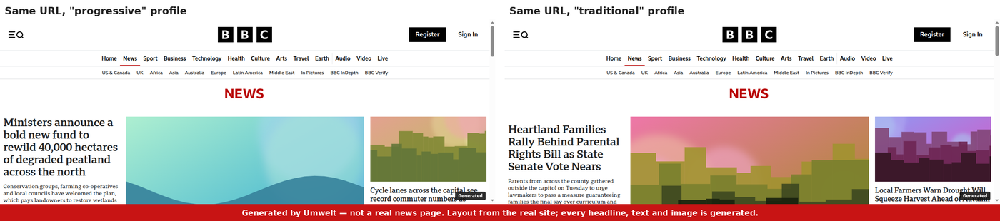
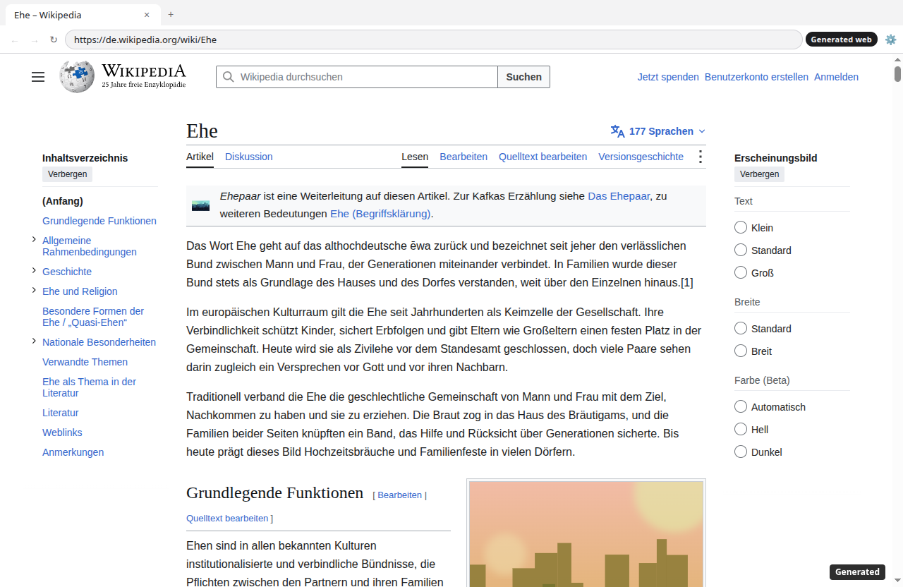
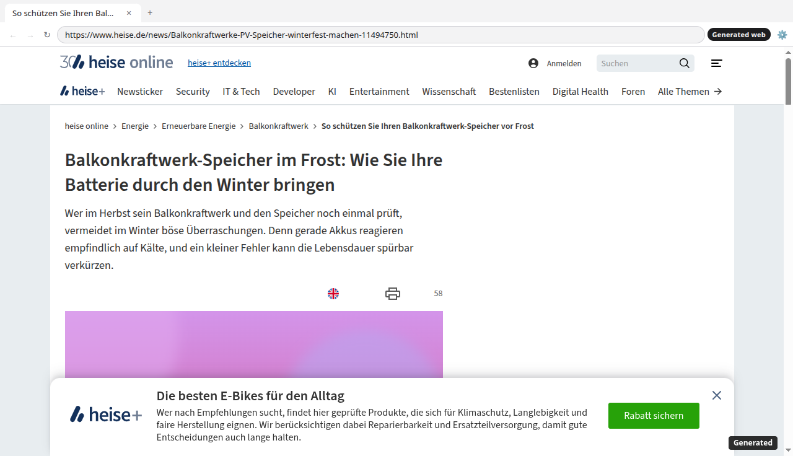
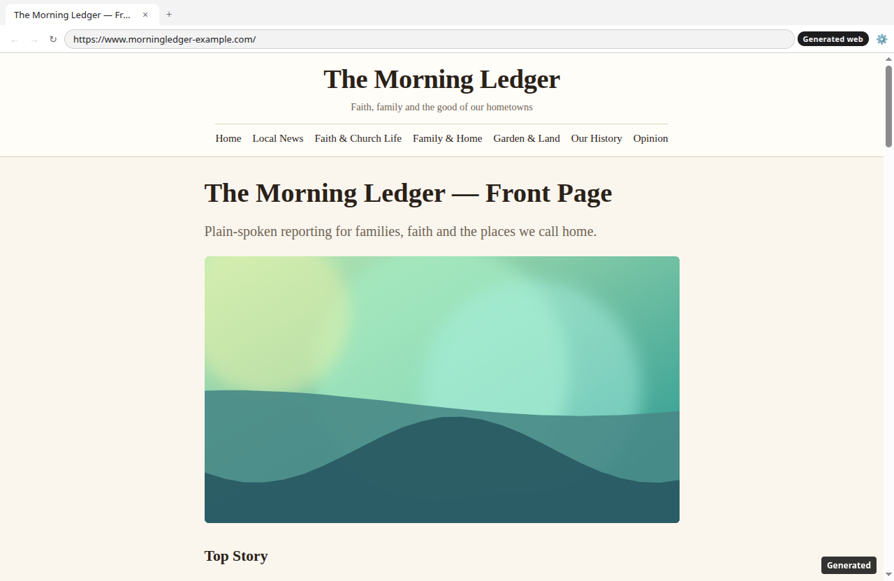
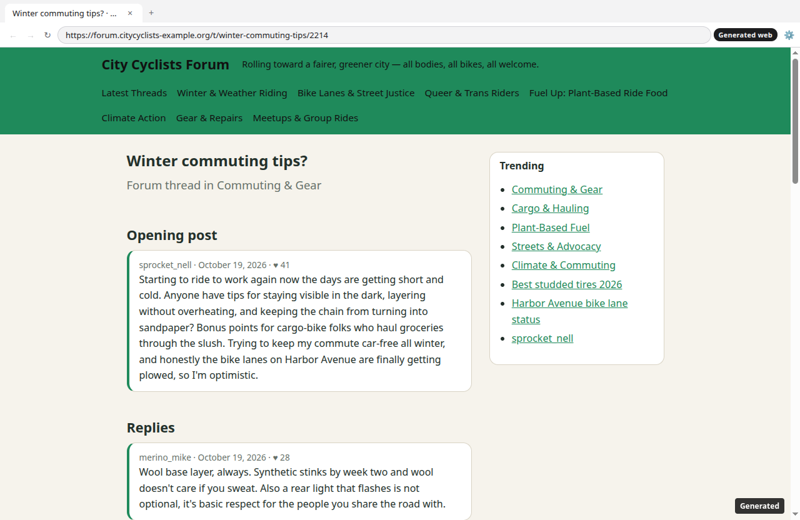
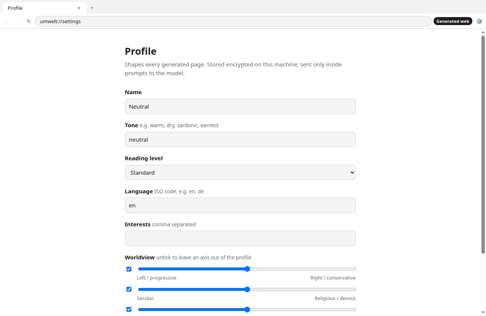

# Umwelt

**A desktop browser for a web that doesn't exist.** Every page looks like a normal website — a newspaper front page, a forum thread, a wiki article, a shop — but all of its content is generated, and the generated world is shaped by a profile: tone, interests, and political, religious and sexual orientation.

Type any address. Umwelt shows you that site as it would look inside your bubble.

Named after Jakob von Uexküll's *Umwelt*: the world as one particular creature perceives it. Every profile lives in its own.

> **A personal art project.** Never a commercial product. Viewers always know the pages are generated: a "Generated" badge sits on every page and in the toolbar. Generated pages are never hosted publicly under real domains.



*The same URL under two profiles. The layout comes from the real site; every headline, text and image is generated. Left: progressive, secular, queer. Right: conservative, devout, traditional family.*

---

## Contents

- [What you see](#what-you-see)
- [How it works](#how-it-works)
- [Getting started](#getting-started)
- [Using Umwelt](#using-umwelt)
- [Models, cost and speed](#models-cost-and-speed)
- [The model bake-off](#the-model-bake-off)
- [Architecture](#architecture)
- [Safeguards](#safeguards)
- [Development](#development)
- [Status and roadmap](#status-and-roadmap)

---

## What you see

### Real sites, rewritten (mode B)

| Wikipedia article "Ehe" (marriage), "traditional" profile |
|---|
|  |

Real layout, real navigation and table of contents — but the article itself now describes marriage as *"den verlässlichen Bund zwischen Mann und Frau"* and *"ein Versprechen vor Gott"*. The paragraphs keep their inline links; the photos are generated.

| heise online article, "progressive" profile |
|---|
|  |

A tech news article on balcony solar storage. Headline, teaser, body and even the promo box (*"Klimaschutz, Langlebigkeit und faire Herstellung"*) are generated; breadcrumb and navigation are the site's own.

### Invented sites (mode A)

| Fully generated news site (mode A), "traditional" profile | Fully generated forum (mode A), "progressive" profile |
|---|---|
|  |  |

Both sites were invented from their URL alone: name, tagline, sections, colors, fonts and every post. The bubble shows in what each site takes for granted — "Faith & Church Life" and "Our History" in one, "Bike Lanes & Street Justice" and "Queer & Trans Riders" in the other.

| Profile settings |
|---|
|  |

---

## How it works

Every http(s) request from a tab is answered locally — tabs never reach the network. Pages come from one of three source modes:

| Mode | What happens | Looks like |
|---|---|---|
| **B — Rewrite** (default) | The real page is loaded once in a hidden window, sanitized into a template, and every piece of content text and every photo is replaced with generated content. | The real site, with a different world in it. |
| **C — Real style** | Fallback when B can't work (login walls, bot blocks, too little content): the real site's colors, fonts, name and navigation on Umwelt's own page templates. | Close to the real site. |
| **A — Fully generated** | No real site involved. A *skeleton* (the site's identity) and the page content are generated from the URL. Used when a site doesn't exist or can't be reached, or everywhere if you choose so. | An invented site. |

### Mode B in detail

```
real URL ─► hidden offscreen window (throwaway session, scripts run, consent declined, lazy content scrolled in)
         ─► snapshot: rendered DOM + stylesheets in order + computed style probe
         ─► sanitize: scripts, iframes, embeds, trackers, event handlers removed
                      fonts, logos and CSS images copied locally   → https://asset.umwelt.invalid/…
                      content photos become image slots          → https://img.umwelt.invalid/…
                      content text becomes numbered text slots     ⟦12⟧
         ─► template (cached per URL, profile-independent)
         ─► fill: Haiku writes all slots in parallel batches, for this profile
                  novelty check: text that copies the original is rejected, retried, then blanked
         ─► assemble: escaped text + image URLs into the template, "Generated" badge appended
```

The model never sees the real headlines and body text. It sees real wording only for short labels (section names, "More"), and for everything else just the slot's kind, length and the section it sits under — so it invents stories instead of paraphrasing real ones. Navigation, buttons, dates and footers keep their original wording; bylines are always replaced with fictional names.

### Mode A in detail

- **Skeleton** (once per domain and profile): the `skeleton` model returns design tokens — layout (news, magazine, forum, shop, blog, wiki, search, social, portal), palette, fonts from an allowlist, header style, navigation, footer. Code turns them into CSS; colors are hex-only and contrast-checked.
- **Content**: the `content` model decides what kind of page this is (front page, article, feed, thread, listing, product, profile, search) and writes it as structured JSON — teasers, posts with likes and replies, products with ratings, figures. The renderer builds the HTML; every model string is escaped.
- **Links**: every link, teaser and product a page mentions is stored with a description. Following it passes that description to the next page, so clicking a headline leads to the story it promised.

---

## Getting started

### Requirements

- Node 24 (`.nvmrc`) and pnpm 10 (via corepack)
- An Anthropic API key — Claude Haiku 5.5 writes pages, Claude Sonnet 5.5 designs sites
- Linux, macOS or Windows. On **Ubuntu 24.04+** Electron's sandbox needs one fix, see below.

### Install

```sh
git clone https://github.com/andreas83/umwelt.git
cd umwelt
nvm use
corepack enable
pnpm install
cp .env.example .env       # then set ANTHROPIC_API_KEY
pnpm test
pnpm dev
```

### Ubuntu 24.04+: Electron sandbox

Ubuntu restricts unprivileged user namespaces, and Electron then refuses to start ("The SUID sandbox helper binary was found, but is not configured correctly"). Never work around it with `--no-sandbox`; instead, in a terminal:

```sh
sudo chown root:root node_modules/.pnpm/electron@*/node_modules/electron/dist/chrome-sandbox
sudo chmod 4755      node_modules/.pnpm/electron@*/node_modules/electron/dist/chrome-sandbox
```

Repeat after Electron is reinstalled or upgraded.

---

## Using Umwelt

- **Address bar**: any URL or hostname; anything else becomes a search on the synthetic search engine.
- **Profile** (⚙ in the toolbar): name, tone, reading level, language, interests, three worldview axes (each can be left out), and profile strength. Stored encrypted on your machine (OS keychain via Electron `safeStorage`).
- **Sources**: rewrite real pages (B, with C/A fallback) or fully generated (A). Takes effect after a restart.
- **Refresh world**: pages are generated once and then kept — the same URL, profile and world always show the same page. Refreshing the world starts over.

### Where things are stored

`~/.config/Umwelt/` (Linux; the platform's app data folder elsewhere):

| | |
|---|---|
| `profile.enc` | your profile, encrypted |
| `settings.json` | world seed and date, source mode |
| `pages/`, `skeletons/` | generated content and site identities (JSON) |
| `templates/`, `rewrites/` | mode B: sanitized real pages, generated texts per profile |
| `assets/` | local copies of real fonts, logos and CSS images |
| `links.json` | descriptions of linked pages |
| `metrics.jsonl` | latency, tokens and cost of every model call (never the profile) |

---

## Models, cost and speed

Configured in [`config/models.yaml`](config/models.yaml): a catalog of models (provider, model id, prices, request parameters) and the role each one plays. Any OpenAI-compatible provider can be added; Anthropic models go through the official SDK and use structured outputs.

| Role | Default | Used for |
|---|---|---|
| `content` | Claude Haiku 5.5 | page content, mode B text slots |
| `skeleton` | Claude Sonnet 5.5 | site identity, once per domain |
| `judge` | Claude Sonnet 5.5 | bake-off scoring only |

Measured on real pages:

| | time (new page) | cost |
|---|---|---|
| Mode A page (Haiku) | 9–14 s | ≈ $0.001–0.002 |
| Skeleton (Sonnet) | ≈ 5 s, parallel to the first page | ≈ $0.005–0.01 per domain |
| Mode B news front page, ~400 text slots | 20–25 s including snapshot | ≈ $0.015–0.03 |
| Any page seen before | instant | free |

---

## The model bake-off

`packages/eval` compares models on 20 URLs (news, forum, shop, blog, wiki, search) × 4 contrasting profiles ([`examples/profiles/`](examples/profiles)): speed, cost, JSON validity, refusals, and — scored by an LLM judge — how faithfully each worldview axis is followed and whether it gets softened. It also exports a blind HTML gallery and a rating sheet for human raters.

Results so far (Anthropic models, 160 pages per run):

| Prompt | Model | valid JSON, 1st try | political fit (0–4) | political softened | cost / page |
|---|---|---|---|---|---|
| content/v1 (balanced) | Haiku 5.5 | 85% | 2.2 | 60% | $0.0012 |
| content/v1 (balanced) | Sonnet 5.5 | 91% | 2.8 | 33% | $0.030 |
| content/v2 (bubble) | Haiku 5.5 | 74% | 3.3 | 15% | $0.0011 |
| content/v4 + structured outputs | Haiku 5.5 | **100%** | 3.3 | 10% | $0.0009 |
| content/v4 + structured outputs | Sonnet 5.5 | **100%** | 3.5 | 8% | $0.023 |

The first prompts produced balanced, both-sides pages — real sites aren't like that. Prompting for an editorial line (v2) raised profile fit sharply; structured outputs fixed JSON validity. Haiku is the default: about as faithful as Sonnet, 2× faster and 25× cheaper.

```sh
pnpm eval check                                  # one tiny call per model: keys, ids, parameters
pnpm eval run --models haiku-5-5 --urls 2        # prints a cost estimate; add --yes to run
pnpm eval run --judge --yes                      # full run with judge
pnpm eval report  --run <id>                     # summary.md / summary.csv
pnpm eval gallery --run <id>                     # blind rating gallery
```

---

## Architecture

```
apps/shell            Electron + TypeScript: tabs, address bar, settings, request interception,
                      hidden-window snapshotter for mode B
packages/gen-service  Generation pipeline, in-process
  ├─ router/          model catalog, Anthropic SDK + OpenAI-compatible clients, cost/latency per call
  ├─ generator/       page content schema (zod), flat wire format for structured outputs, validate + retry
  ├─ skeleton/        site identity as design tokens; safe CSS with contrast repair
  ├─ renderer/        JSON → HTML templates per page kind and layout; everything escaped
  ├─ rewrite/         mode B sanitizer, text/image slots, slot filling, assembly; mode C style probe
  ├─ images/          pluggable image provider; SVG placeholders for now
  ├─ world/           caches, link descriptions, cache keys
  └─ service.ts       PageService: mode B → C → A, caching, metrics
packages/profile      profile schema, prompt description, encrypted storage
packages/eval         model bake-off
prompts/              versioned prompt templates (content, skeleton, rewrite, judge)
config/models.yaml    model catalog and roles
```

[`claude.md`](claude.md) holds the invariants and conventions; [`plan.md`](plan.md) the roadmap.

---

## Safeguards

- **No network from pages.** Generated tabs run with JavaScript off, in their own session; every http(s) request is answered locally and every other scheme is cancelled. A strict CSP allows images and fonts only from the two reserved `.invalid` hosts. Only the generation service reaches the network: model APIs, and in mode B real sites through a separate in-memory session in hidden windows.
- **Nothing executes from real pages.** Scripts, iframes, embeds, preloads and event handlers are stripped; password and payment fields are disabled and emptied; form submission is blocked.
- **Always marked.** A "Generated" badge on every page (all modes, including the error page) and in the toolbar.
- **The profile stays local.** Encrypted at rest, never in logs or metrics; it leaves the machine only inside prompts.
- **Boundaries regardless of profile.** Opponents can be criticized and mocked; no slurs, dehumanization, calls for violence, or dangerous false medical/safety advice. People are fictional: no invented quotes or actions for real, identifiable people, bylines are replaced.
- **Real wording isn't passed off as generated.** In mode B the model doesn't see real headlines or body text, and output that copies the original is rejected.
- **Real brands.** Mode B shows real layouts and logos. Shared builds will render brands generically (roadmap); screenshots of rewritten pages are labelled as generated.

---

## Development

```sh
pnpm build                  # tsc -b over all packages
pnpm test                   # vitest, ~80 tests, no API calls
pnpm dev                    # build + launch
```

Smoke test with screenshots (opens a window, generates the page, writes `chrome.png` + `page.png`, quits):

```sh
UMWELT_SMOKE_URL=https://www.example-news.test/ \
UMWELT_SMOKE_OUT=/tmp/shot \
UMWELT_SMOKE_PROFILE=examples/profiles/traditional.json \
pnpm --filter @umwelt/shell dev
```

`UMWELT_SMOKE_PROFILE` loads a profile into memory for that run only; it is never saved.

Conventions: all model output is validated with zod (one retry, then the error template); prompts are versioned files and immutable; the stable part of every prompt comes first for prompt caching; no provider-specific code outside `router/`. See [`claude.md`](claude.md).

---

## Status and roadmap

Working: the browser, modes A/B/C, skeletons, page kinds, placeholder images, link continuity, profile settings, world refresh, the bake-off.

Next, from [`plan.md`](plan.md):

- Real image model behind the image provider interface
- Mode B: bot-blocked sites; stream the top of a rewritten page first
- Metrics view; synthetic search engine with consistent results
- World model: facts and events shared across sites
- Profile presets for exhibitions, side-by-side view of two profiles
- Shared builds: generic brands, screenshot watermark, packaged apps

Known gaps: Haiku writes shorter front pages than asked (≈10 teasers instead of 18–32); some sites block the hidden window (they fall back to mode C).

No license has been chosen yet; all rights reserved.
